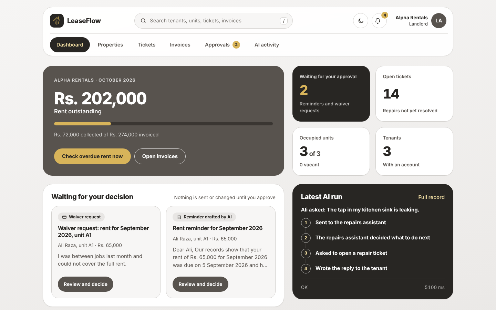
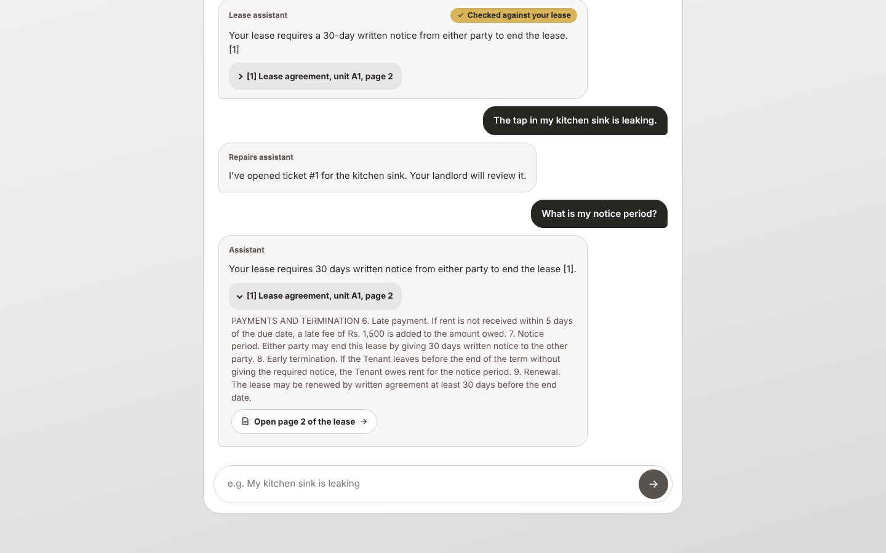
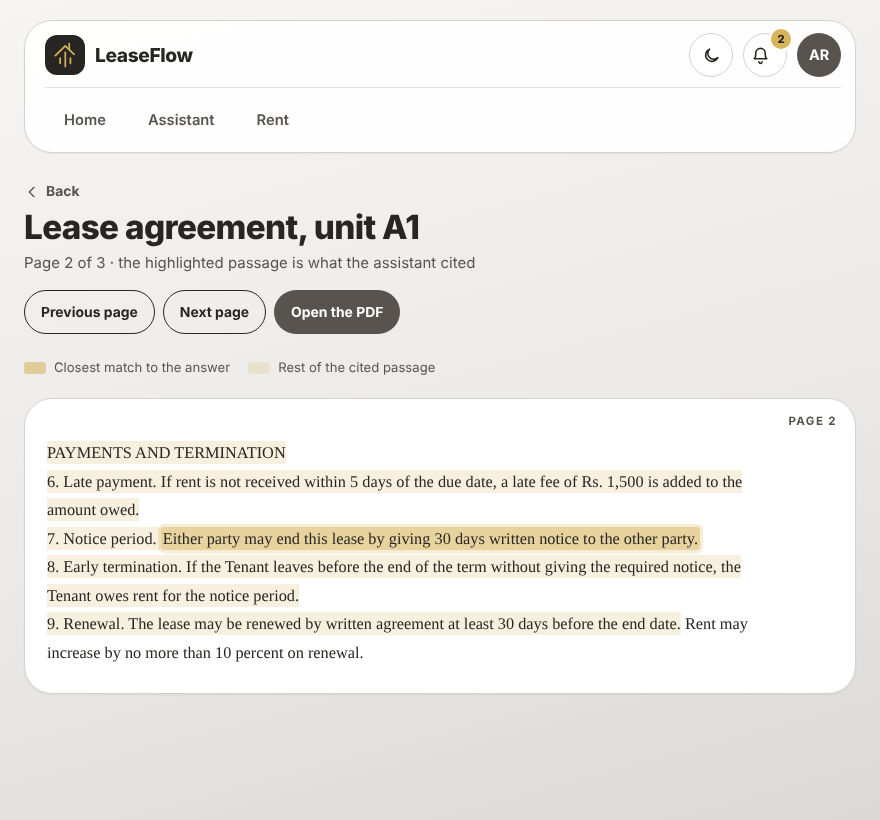
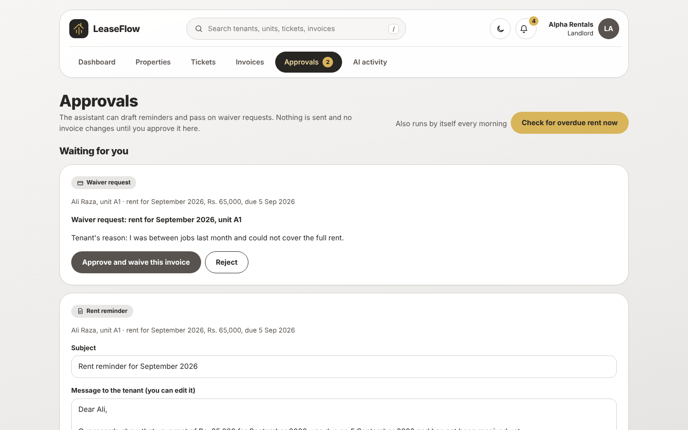
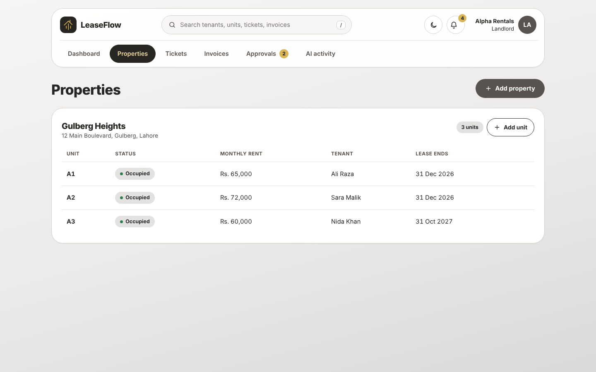
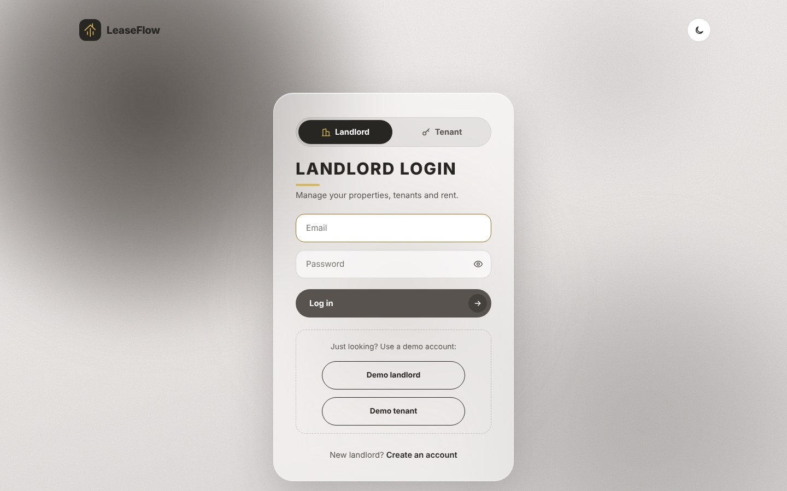
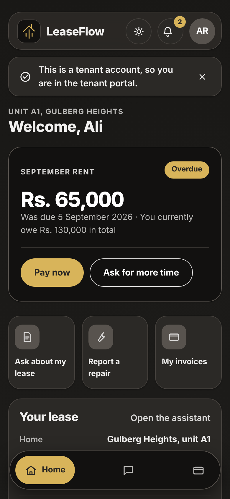
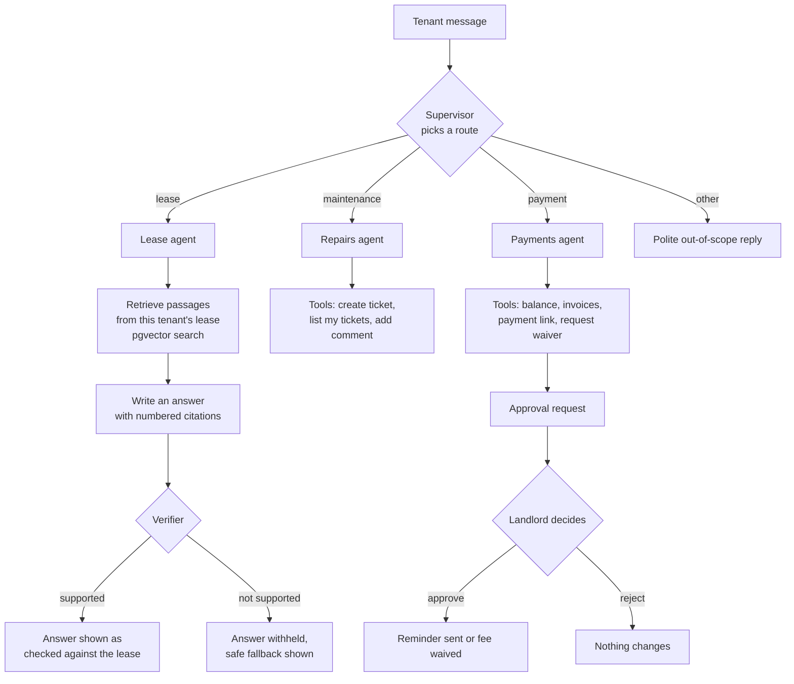

# LeaseFlow

**Rental management with AI you can check.** Tenants ask about their lease, report repairs and sort out rent in a chat. Every lease answer cites the page it came from and is verified before it is shown, and anything that touches money waits for the landlord's approval.

**Live demo:** https://leaseflow-iyku.onrender.com

Click **Demo landlord** or **Demo tenant** on the login page to look around; no sign-up needed. The demo runs on a free plan that sleeps when idle, so the first page can take up to a minute to load.

To see that one business cannot see another's data, log in as the second landlord, `landlord@beta.test`, with the password `demo12345`.

The login page has one-click **Demo landlord** and **Demo tenant** buttons. The demo runs on a free plan that sleeps when idle, so the first page can take up to a minute to load.



## Contents

- [What it does](#what-it-does)
- [How the assistant works](#how-the-assistant-works)
- [Why you can trust its answers](#why-you-can-trust-its-answers)
- [Evaluation results](#evaluation-results)
- [Security](#security)
- [Tech stack](#tech-stack)
- [Project layout](#project-layout)
- [Run it locally](#run-it-locally)
- [Tests and evals](#tests-and-evals)
- [Deployment](#deployment)
- [Limitations](#limitations)

## What it does

**For tenants**

- Ask questions about their own lease and the building rules, and get answers with page citations.
- Open the cited lease page, with the cited passage highlighted next to the original PDF.
- Report a repair in plain language; the assistant opens a ticket and the tenant can follow it.
- See invoices, pay rent, or ask for more time.

**For landlords**

- A dashboard of rent outstanding, open tickets, occupancy and what is waiting for a decision.
- Add properties and units, and invite tenants with a one-time link.
- Approve or reject what the assistant drafts: rent reminders and waiver requests.
- A step-by-step record of every assistant run.
- Search across tenants, units, tickets and invoices, plus in-app notifications.

| Tenant asks, the answer cites the lease | The cited page, with the passage highlighted |
| --- | --- |
|  |  |

| Approvals inbox | Properties and invitations |
| --- | --- |
|  |  |

| Login | Tenant home on a phone, dark mode |
| --- | --- |
|  |  |

| Splash screen, light mode | Splash screen, dark mode |
| --- | --- |
|  |  |

The logo draws itself line by line with a gold glow, then the app opens on the login page. It plays once per browser tab.

## How the assistant works

A supervisor reads each message and hands it to one of three specialist agents. Each agent can only use the tools it has been given, and each tool is bound to the logged-in tenant, so an agent cannot reach another tenant's data even if it is asked to.



- **Lease agent** (LangGraph: retrieve, generate, verify). It answers only from passages retrieved from the tenant's own lease and their building's policy document.
- **Repairs agent** (tool loop). It turns "the tap in my kitchen is leaking" into a categorised, prioritised ticket.
- **Payments agent** (tool loop). It can report a balance and create a payment link. It cannot waive a fee or send a reminder; it can only file a request for the landlord.
- **Scheduled overdue check.** Once a day the system marks late invoices and drafts a reminder for each, which then waits in the landlord's approvals inbox.

## Why you can trust its answers

1. **Citations.** Every lease answer lists the passages it used. Each one links to the lease page, where the passage is highlighted.
2. **A verifier that fails closed.** Before a lease answer is shown, code checks that it cites at least one source and only sources it was given. Then a second model call checks that the sources really say what the answer claims. If either check fails, the tenant gets a safe fallback instead of the answer.
3. **Human approval for anything that matters.** Reminders and waivers are drafts until a landlord approves them. The agent has no tool that sends or waives.
4. **Deterministic rules around the model.** Balances, invoice states, permissions and tenant isolation are plain code and database constraints, not model output.
5. **A record of every run.** Each run stores its route, every model and tool step, timings, tokens and estimated cost. Landlords see what happened; cost figures are shown to staff accounts only.

## Evaluation results

The project has its own eval and red-team suite. It runs the real agents against a seeded database and checks both the reply and any side effects in the database.

| Group | What it checks | Result |
| --- | --- | --- |
| Quality (11 cases) | Correct lease answers with the right page cited, correct routing, "not in your lease" handled | 11 / 11 |
| Red team (12 cases) | Other tenants' and other organisations' data, prompt injection in messages, documents and ticket text, false claims of authority, and a verifier that must reject wrong numbers and promises | 12 / 12 |

Latest full run (9 October 2026, `openai/gpt-oss-120b`): **23 / 23 passed**, using 26,719 input and 5,731 output tokens, about **$0.007 for the whole suite**. The full table is in [`docs/eval-report.md`](docs/eval-report.md).

These numbers describe a small, fixed set of cases on demo data. They show the safeguards hold against the attacks tested; they are not a guarantee about every possible input.

## Security

- **Tenant isolation.** Every business's rows carry its organisation, every query is scoped to it, and tests confirm one organisation cannot read another's data.
- **Role-based access.** Tenant and landlord pages are checked on the server; hiding a link is never the only protection.
- **Invitations.** One-time links valid for 7 days. Only a SHA-256 hash of the token is stored. Used, expired, cancelled and invalid links all return the same page. A returning tenant must enter their existing password, so an invitation cannot take over an account.
- **Profiles.** A person can only edit their own record; role, email and organisation cannot be changed through the form.
- **Documents.** Lease pages and PDFs are served only to the tenant on that lease or their landlord. Other requests get "not found".
- **Agents.** Tools are bound to the current user, money actions need approval, and the red-team suite covers prompt injection through three different channels.
- **Production.** HTTPS only, HSTS, secure cookies, host validation, secrets from environment variables, and a secret-protected endpoint for scheduled jobs.

## Tech stack

| Layer | Choice |
| --- | --- |
| Backend | Python 3.13, Django 5.2 |
| Agents | LangGraph, LangChain tool calling |
| Chat model | `openai/gpt-oss-120b` on Groq |
| Embeddings and search | Gemini embeddings, Postgres with pgvector (HNSW index, cosine distance) |
| Database | Postgres on Neon |
| Frontend | Django templates, HTMX, plain CSS with light and dark themes |
| Background jobs | Celery tasks; on the free demo they are started by a GitHub Actions schedule |
| Payments | A provider interface with a simulated gateway (signed webhook) and manual payments |
| Hosting | Render, with static files served through WhiteNoise |
| Quality | pytest (232 tests), ruff, GitHub Actions CI |

## Project layout

```
apps/
  accounts/       users, organisations, sign-up, portal login, profiles
  properties/     properties, units, leases, tenant invitations
  documents/      lease PDFs, chunking, embeddings, search, the lease page viewer
  maintenance/    repair tickets and their history
  billing/        invoices, payments, payment providers, webhooks
  agents/         supervisor, the three agents, tools, verifier, approvals,
                  tracing, cost estimates, the eval and red-team suite
  notifications/  in-app notifications
  dashboard/      landlord and tenant pages, search
  core/           shared models, AI clients, health check, scheduled jobs
config/           settings (base, dev, test, prod) and URLs
templates/        HTML templates
static/           CSS (tokens, base, layout, components, pages, responsive) and JS
tests/            one file per area
docs/             eval report and screenshots
```

## Run it locally

You need Python 3.13, a Postgres database where the pgvector extension can be enabled (a free Neon database works), a Redis URL, a Groq API key and a Google AI API key.

```bash
git clone https://github.com/aqsak-dev99/leaseflow.git
cd leaseflow
python -m venv .venv
source .venv/bin/activate
pip install -r requirements/dev.txt

cp .env.example .env                  # then fill in the values
python manage.py migrate
python manage.py seed_demo --embed    # demo data; --embed calls the embedding API
python manage.py runserver
```

Open http://127.0.0.1:8000 and log in with a demo account. All demo accounts use the password `demo12345`.

## Tests and evals

```bash
ruff check .
pytest                                             # 232 tests; model calls are faked, so this is free

python manage.py run_evals                         # the full eval and red-team suite (calls the model)
python manage.py run_evals --group redteam         # one group
python manage.py run_evals --report docs/eval-report.md
```

## Deployment

The repository includes a [`render.yaml`](render.yaml) blueprint. On Render, choose **New → Blueprint**, pick the repository, and supply `DATABASE_URL`, `REDIS_URL`, `GROQ_API_KEY` and `GOOGLE_API_KEY`. The build script installs dependencies, collects static files, runs migrations and restores the demo PDFs.

The free plan sleeps when idle and has no background workers, so the two scheduled jobs (monthly invoices and the daily overdue check) are started by [`.github/workflows/scheduled.yml`](.github/workflows/scheduled.yml), which calls a secret-protected endpoint. On paid hosting the same jobs can run through Celery beat.

## Limitations

- **Payments are simulated.** There is a working provider interface and webhook flow, but no real payment gateway.
- **Lease PDFs come from demo data.** There is no upload screen yet, so a newly invited tenant has a lease record but no document for the assistant to answer from.
- **Invitation emails are not sent on the demo.** The free host blocks email, so the landlord copies the invitation link instead.
- **Free-tier model limits.** Replies can be slow or briefly unavailable when the model provider's rate limit is reached.
- **The "closest sentence" highlight is a reading aid.** It is chosen by word overlap with the answer; the full cited passage is always highlighted as well.
- **No content security policy header yet.**

## Author

Built by Aqsa Khan, final-year BSc Computing student.
